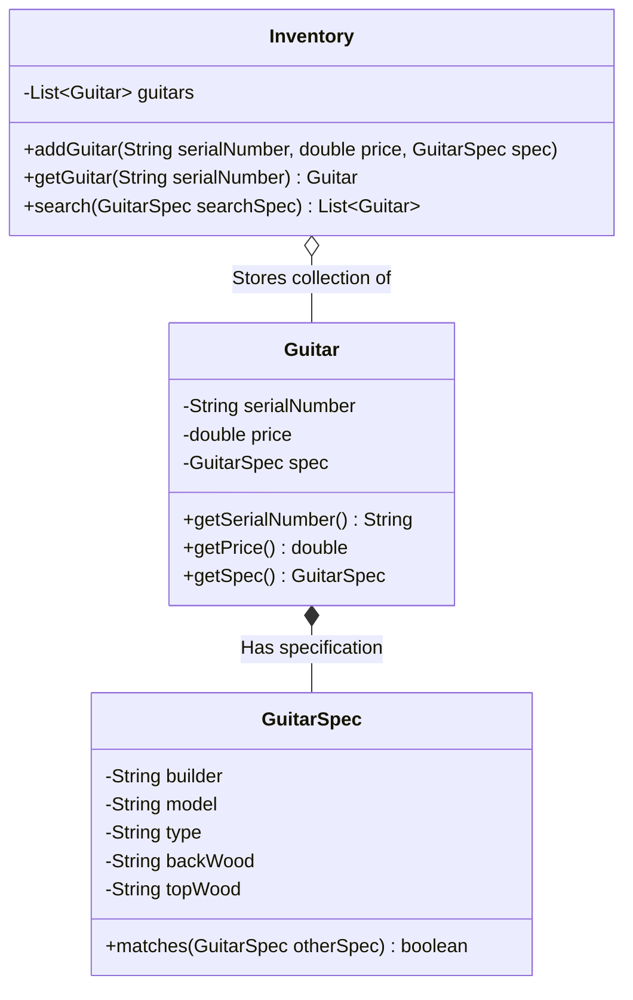

# 🎸 Guitar Inventory System — Object-Oriented Specification Pattern Catalog

<p align="center">
  
</p>

<p align="center">
  <b>Extensible Object-Oriented Software Design: Applying the GoF Specification Pattern to Decouple Inventory State from Parametric Search Queries.</b>
</p>

<p align="center">
  
  
  
  
</p>

<p align="center">
  
</p>

---

<a id="table-of-contents"></a>
## 📌 Table of Contents

- [📖 Executive Summary & Overview](#executive-summary--overview)
- [🎯 Key Features & Capabilities](#features)
- [🏗️ System Architecture & Pipeline](#system-architecture--pipeline)
- [🛠️ Tech Stack Breakdown](#tech-stack-breakdown)
- [⚙️ Reproducible Quickstart & Setup](#setup)
- [📁 Project Directory Layout](#project-layout)
- [🧪 Testing & Verification](#testing--verification)
- [🔮 Future Improvements & Roadmap](#future-improvements--roadmap)
- [🤝 Contributing Guidelines](#contributing-guidelines)
- [👨‍💻 Author & Contributions](#author--contributions)

---

<a id="executive-summary--overview"></a>
## 📖 Executive Summary & Overview

Developing enterprise retail inventory applications requires designing flexible software architectures resilient to catalog changes. Hardcoding instrument search criteria directly into inventory loops violates the Single Responsibility and Open/Closed principles, rendering systems brittle when introducing new attributes (such as back woods, string counts, or electronic pickups).

The **Guitar Inventory System** (`GuiterInventory-System`) implements an object-oriented inventory catalog inspired by classic software engineering design patterns. By decoupling instrument specifications from the physical inventory storage entity, the system provides high search flexibility, type safety, and clean algorithmic filtering.

---

<a id="key-features--capabilities"></a>
## 🎯 Key Features & Capabilities

### 🔍 1. GoF Specification Pattern
- Separating physical inventory items (`Guitar`) from their searchable properties (`GuitarSpec`).

### 🏷️ 2. Parametric Matching Algorithm
- Flexible multi-attribute search comparing client query criteria against current inventory records.

---

<a id="system-architecture--pipeline"></a>
## 🏗️ System Architecture & Pipeline



---

<a id="tech-stack-breakdown"></a>
## 🛠️ Tech Stack Breakdown

| Layer | Technology | Role |
| :--- | :--- | :--- |
| **Language** | Java (JDK 11 / 17 LTS) | Core object-oriented programming language |
| **Data Structures** | Java Collections Framework | Dynamic list storage, iteration, and filtering |
| **Software Design** | Gang of Four (GoF) Principles | Encapsulation, Specification Pattern, Separation of Concerns |

---

<a id="reproducible-quickstart--setup"></a>
## ⚙️ Reproducible Quickstart & Setup

### Prerequisites
- JDK 11 or higher installed

```bash
# 1. Clone repository
git clone https://github.com/Amaraiah11/GuiterInventory-System.git
cd GuiterInventory-System

# 2. Compile Java sources
javac Inventory.java

# 3. Execute inventory simulation
java Inventory
```

---

<a id="project-directory-layout"></a>
## 📁 Project Directory Layout

```text
GuiterInventory-System/
├── Inventory.java             # Core inventory management logic and catalog search
└── README.md                  # Comprehensive OOP architectural documentation
```

---

<a id="testing--verification"></a>
## 🧪 Testing & Verification

- Verified partial query matching (e.g. matching on builder and wood type while leaving model empty) correctly returns matching instruments.

---

<a id="future-improvements--roadmap"></a>
## 🔮 Future Improvements & Roadmap

- [ ] Transition from string constants to type-safe Java `Enum` types for Builders and Wood types.
- [ ] Add SQLite JDBC persistence layer for long-term inventory storage.

---

<a id="author--contributions"></a>
## 👨‍💻 Author & Contributions

This project is developed and maintained with rigorous engineering standards by **Amaraiah C**, Software Developer and Applied Data Analytics Practitioner studying Bachelor of Computer Applications (BCA) at Alliance University, Bangalore.

- 🌐 **GitHub Profile:** [@Amaraiah11](https://github.com/Amaraiah11)
- 💼 **LinkedIn Profile:** [Connect on LinkedIn](https://www.linkedin.com/in/amaraiah-c/)
- 📧 **Institutional Email:** `camaraiahBCA24@ced.alliance.edu.in`

### 🤝 Contributing Guidelines
Contributions, bug reports, and architectural discussions are welcome!
1. **Fork** the repository: `https://github.com/Amaraiah11/GuiterInventory-System`
2. **Create a Feature Branch:**
   ```bash
   git checkout -b feature/your-feature-name
   ```
3. **Commit Your Enhancements:**
   ```bash
   git commit -m "feat: enhance feature logic"
   ```
4. **Push to Your Branch:**
   ```bash
   git push origin feature/your-feature-name
   ```
5. **Open a Pull Request** against the `Amaraiah-C` branch.

---

<p align="center">
  <b>⭐ If this codebase or documentation assisted your engineering workflows, please star the repository! ⭐</b>
</p>

<p align="center">
  
</p>
