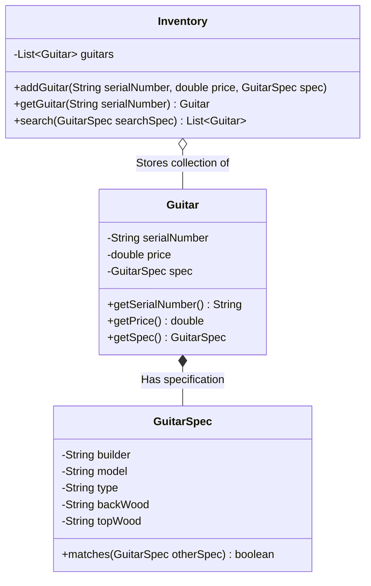

<p align="center">
  
</p>

<p align="center">
  
  
  
  
</p>

<a id="overview"></a>
## 📖 Executive Summary & Overview

Developing enterprise retail inventory applications requires designing flexible software architectures resilient to feature expansion and domain changes. Hardcoding instrument search criteria directly into inventory loops violates the Single Responsibility and Open/Closed principles, rendering systems brittle when introducing new attributes (such as back woods, string counts, or electronic pickups).

The **Guitar Inventory System** (`GuiterInventory-System`) implements an object-oriented inventory catalog inspired by classic software engineering design patterns. By decoupling instrument specifications from the physical inventory storage entity, the system provides high search flexibility, type safety, and clean algorithmic filtering.

<a id="toc"></a>
## 📑 Table of Contents

- [📖 Executive Summary & Overview](#overview)
- [🎯 Key Features & Capabilities](#features)
- [🏗️ System Architecture & Pipeline](#architecture)
- [🛠️ Tech Stack Breakdown](#tech-stack)
- [⚙️ Reproducible Quickstart & Setup](#setup)
- [📁 Project Directory Layout](#project-layout)
- [👨‍💻 Author & Contributions](#author)

<a id="features"></a>
## 🎯 Key Features & Capabilities

- **Encapsulated Inventory Management:** Centralized catalog holding item records with dynamic addition, lookup, and retrieval.
- **Specification Matching Algorithm:** Flexible multi-criteria attribute comparison matching user preferences against stock.
- **Type-Safe Domain Modeling:** Robust attribute handling for builders (Fender, Gibson, Martin), models, and wood configurations.
- **Decoupled Architecture:** Clean separation between business domain entities, search algorithms, and client execution.

<a id="architecture"></a>
## 🏗️ System Architecture & Pipeline



<a id="tech-stack"></a>
## 🛠️ Tech Stack Breakdown

| Layer | Technology | Role |
| :--- | :--- | :--- |
| **Language** | Java (JDK 11 / 17+) | Core object-oriented programming language |
| **Data Structures** | Java Collections Framework | Dynamic list storage, iteration, and filtering |
| **Software Design** | Gang of Four (GoF) Principles | Encapsulation, Specification Pattern, Separation of Concerns |
| **Build Tooling** | Standard `javac` Compiler | Clean compilation without external dependencies |

<a id="setup"></a>
## ⚙️ Reproducible Quickstart & Setup

### Prerequisites
- Java Development Kit (JDK 11 or higher)

```bash
# 1. Clone repository
git clone https://github.com/Amaraiah11/GuiterInventory-System.git
cd GuiterInventory-System

# 2. Compile Java sources
javac Inventory.java

# 3. Execute inventory simulation
java Inventory
```

<a id="project-layout"></a>
## 📁 Project Directory Layout

```text
GuiterInventory-System/
├── Inventory.java             # Core inventory management logic and catalog search
└── README.md                  # Comprehensive OOP architectural documentation
```

<a id="author"></a>
## 👨‍💻 Author & Contributions

This project is developed and maintained with high technical rigour by **Amaraiah C**, Software Engineer and Data Analytics Practitioner studying Bachelor of Computer Applications (BCA) at Alliance University.

- 🌐 **GitHub:** [@Amaraiah11](https://github.com/Amaraiah11)
- 💼 **LinkedIn:** [Connect on LinkedIn](https://www.linkedin.com/in/amaraiah-c/)
- 📧 **Institutional Contact:** `camaraiahBCA24@ced.alliance.edu.in`

### 🤝 Contribution Guidelines
Contributions, bug reports, and architectural discussions are welcome!
1. **Fork** the repository: `https://github.com/Amaraiah11/GuiterInventory-System`
2. **Branch**: `git checkout -b feature/your-feature-name`
3. **Commit**: `git commit -m "feat: enhance feature logic"`
4. **Push**: `git push origin feature/your-feature-name`
5. **Open Pull Request** against the `Amaraiah-C` branch.

---

<p align="center">
  <b>⭐ If this codebase or documentation assisted your engineering workflows, please star the repository! ⭐</b>
</p>

<p align="center">
  
</p>
